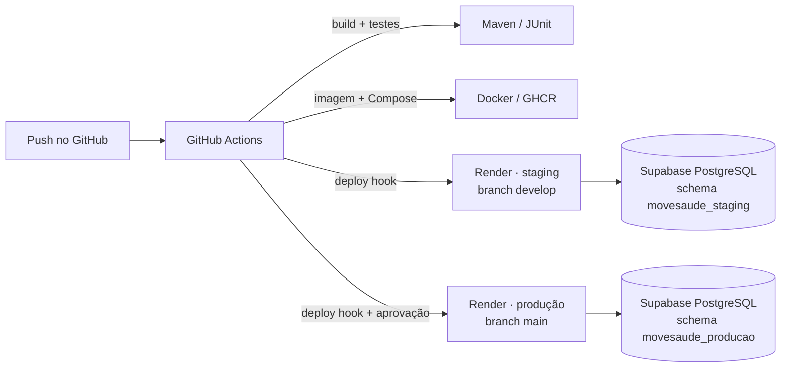
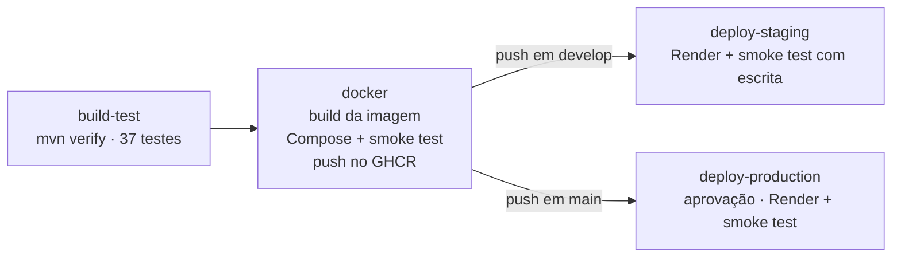
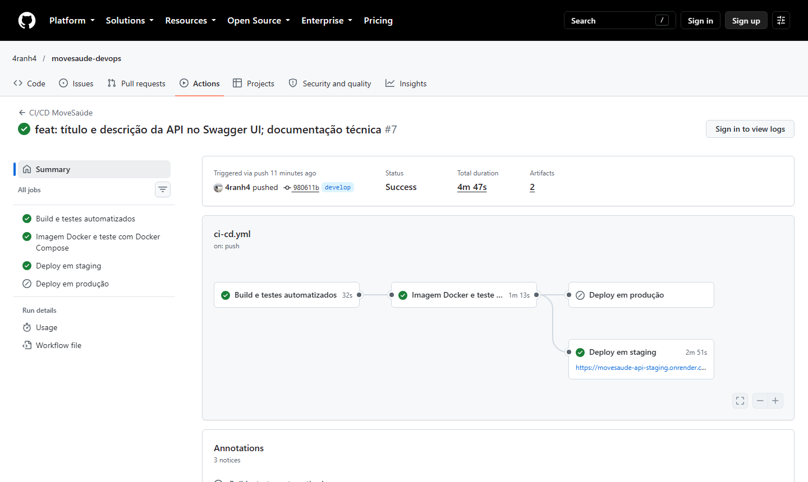
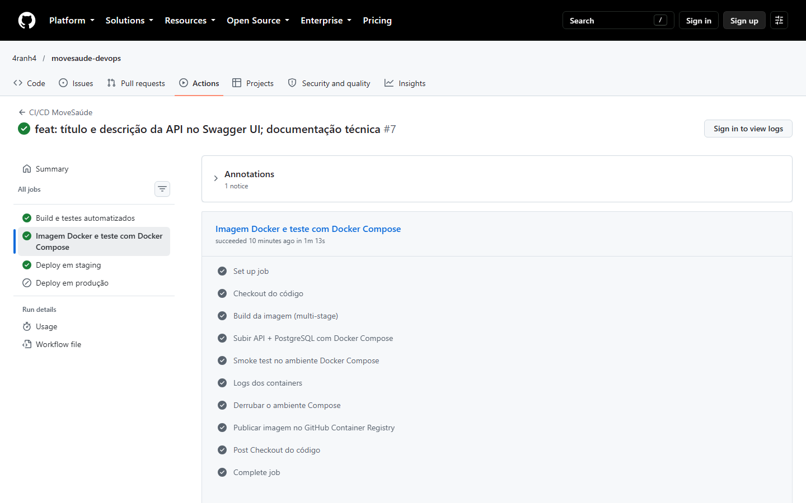
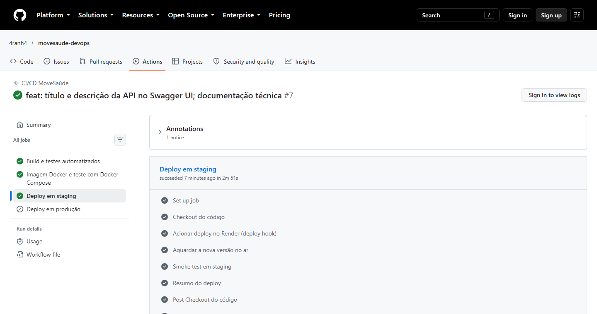
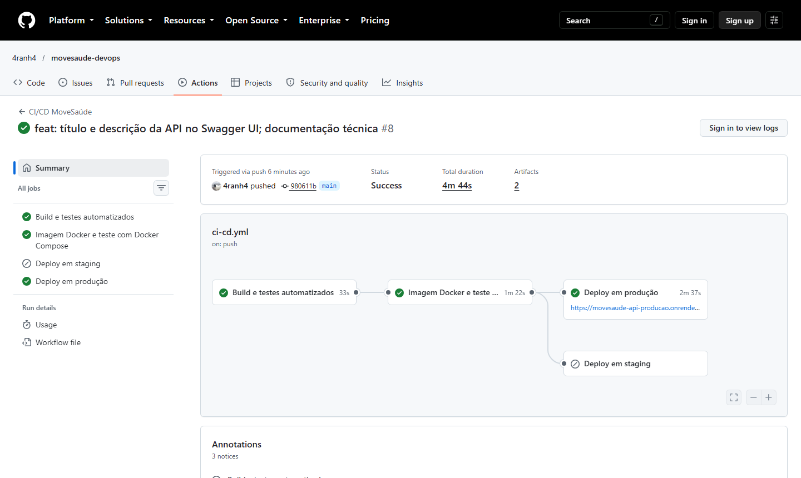
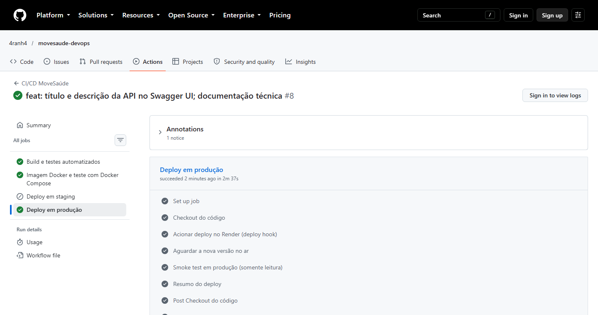
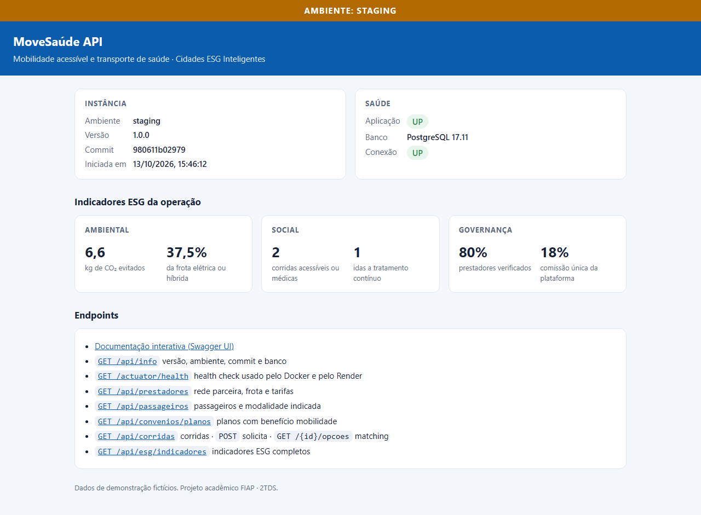
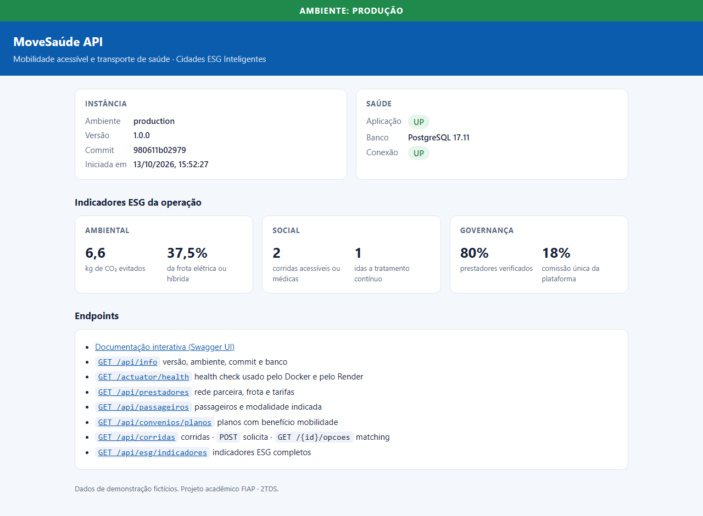
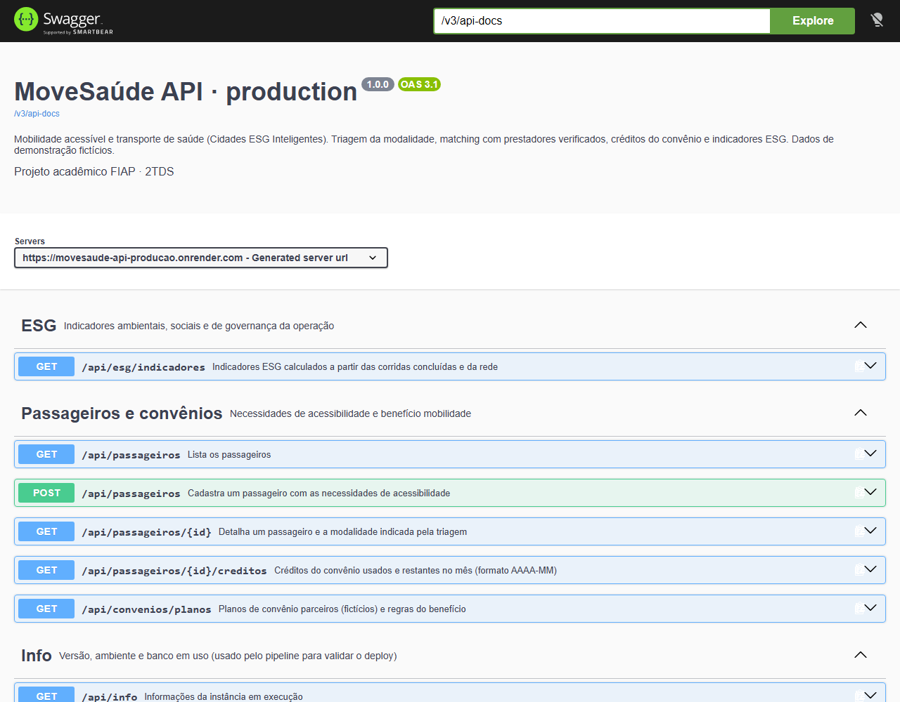

# Projeto - Cidades ESGInteligentes

**MoveSaúde API**: mobilidade acessível e transporte de saúde para pessoas com deficiência, idosos e pacientes em tratamento contínuo.

| Integrante | RM |
|---|---|
| João Pedro Aranha Moscatello | 565854 |
| Lucas Vilarim de Souza | 565685 |

FIAP · 2TDS · Fase "Navegando pelo mundo DevOps"

---

## Sobre o projeto

A MoveSaúde conecta quem precisa chegar a um atendimento de saúde (ou quem cuida dessa pessoa) a uma rede de prestadores verificados: vans com rampa ou elevador, transporte assistido e remoção não emergencial. A plataforma não tem frota própria. O passageiro registra uma vez as necessidades de acessibilidade, a triagem indica a modalidade certa, a central sugere até três opções compatíveis e o convênio pode cobrir a corrida com créditos mensais.

A relação com o tema **Cidades ESG Inteligentes** aparece nos indicadores que a própria API calcula (`GET /api/esg/indicadores`):

| Pilar | O que a API mede |
|---|---|
| **E**, ambiental | km rodados pela frota parceira, CO₂ emitido e evitado por veículos elétricos e híbridos, % da frota limpa |
| **S**, social | corridas acessíveis ou médicas concluídas, idas a tratamentos contínuos (hemodiálise, oncologia, terapia), passageiros atendidos, valor subsidiado pelos convênios |
| **G**, governança | % de prestadores com documentos verificados (só eles recebem corridas), comissão única e preço detalhado linha a linha |

### Arquitetura



| Ambiente | Onde roda | Banco | Branch |
|---|---|---|---|
| Local | Docker Compose (API + PostgreSQL 17) | container `db`, volume `movesaude-pgdata` | qualquer |
| Staging | Render (container Docker) · https://movesaude-api-staging.onrender.com | Supabase PostgreSQL 17, schema e usuário `movesaude_staging` | `develop` |
| Produção | Render (container Docker) · https://movesaude-api-producao.onrender.com | Supabase PostgreSQL 17, schema e usuário `movesaude_producao` | `main` |

Staging e produção usam o mesmo projeto Supabase, mas ficam isolados: cada ambiente tem seu próprio usuário de banco, dono apenas do próprio schema, sem permissão no schema do outro.

---

## Como executar localmente com Docker

Pré-requisito: [Docker Desktop](https://www.docker.com/products/docker-desktop/) (ou Docker Engine + Compose v2).

```bash
# 1. Clonar o repositório
git clone https://github.com/4ranh4/movesaude-devops.git
cd movesaude-devops

# 2. Criar o arquivo de variáveis de ambiente (ajuste a senha do banco se quiser)
cp .env.example .env

# 3. Construir a imagem e subir API + PostgreSQL
docker compose up -d --build

# 4. Acompanhar até os dois serviços ficarem "healthy" (cerca de 1 minuto)
docker compose ps
docker compose logs -f api
```

Com os containers no ar:

| Endereço | O que é |
|---|---|
| http://localhost:8080 | Página inicial: ambiente, versão, saúde e indicadores ESG |
| http://localhost:8080/swagger-ui.html | Documentação interativa da API |
| http://localhost:8080/actuator/health | Health check (usado pelo Docker e pelo Render) |
| http://localhost:8080/api/info | Versão, ambiente, commit e banco em uso |

Validar tudo de uma vez com o smoke test (o mesmo que o pipeline usa):

```bash
./scripts/smoke-test.sh http://localhost:8080 local --fluxo
```

Exemplo do fluxo principal pela API:

```bash
# Solicitar uma corrida para a passageira 1 (cadeirante, convênio Aurora · Cuidado Renal)
curl -X POST http://localhost:8080/api/corridas -H "Content-Type: application/json" \
  -d '{"passageiroId":1,"origem":"Rua Voluntários da Pátria, 1200","destino":"Clínica Renal Norte","distanciaKm":8.4,"data":"2026-12-01","hora":"10:00","idaEVolta":true,"finalidade":"HEMODIALISE"}'

# Ver as opções sugeridas pela central (preço e cobertura do convênio)
curl http://localhost:8080/api/corridas/1/opcoes

# Confirmar com o prestador recomendado e acompanhar o status
curl -X POST http://localhost:8080/api/corridas/1/confirmacao -H "Content-Type: application/json" -d '{"prestadorId":1}'
curl -X PATCH http://localhost:8080/api/corridas/1/status -H "Content-Type: application/json" -d '{"status":"A_CAMINHO"}'
```

Comandos úteis:

```bash
docker compose down        # para os containers e mantém os dados do volume
docker compose down -v     # para e apaga o volume do banco (recomeça do zero)
docker compose build api   # reconstrói só a imagem da API
```

Sem Docker, dá para rodar com H2 em memória (perfil `dev`): `./mvnw spring-boot:run -Dspring-boot.run.profiles=dev`.

---

## Pipeline CI/CD

**Ferramenta:** GitHub Actions ([`.github/workflows/ci-cd.yml`](.github/workflows/ci-cd.yml)). **Hospedagem:** Render (containers Docker) com banco PostgreSQL no Supabase. **Registro de imagens:** GitHub Container Registry (GHCR).



| Job | Quando roda | O que faz |
|---|---|---|
| **Build e testes automatizados** | todo push e pull request em `develop`/`main` | Configura o JDK 25 (Temurin) com cache do Maven, roda `./mvnw verify` (compila, executa os 37 testes e empacota o `.jar`), publica os relatórios de teste e o `.jar` como artefatos e escreve a tabela de testes no resumo da execução |
| **Imagem Docker e teste com Docker Compose** | depois do job anterior | Constrói a imagem multi-stage com o commit gravado (`GIT_SHA`), sobe **API + PostgreSQL** com o `docker-compose.yml`, espera o container ficar `healthy`, roda o smoke test com um fluxo completo de corrida e, em pushes, publica a imagem no GHCR com as tags `sha-<commit>`, `<branch>` e `staging`/`production` |
| **Deploy em staging** | push em `develop` | Aciona o deploy hook do serviço de staging no Render, espera até `/api/info` responder com o commit que acabou de ser testado e roda o smoke test em staging, criando e confirmando uma corrida |
| **Deploy em produção** | push em `main` | Usa o *environment* `production` do GitHub, que pode exigir aprovação manual. Aciona o deploy hook de produção, confirma o commit no ar e roda o smoke test **somente leitura** |

**Lógica do fluxo:**
1. O desenvolvimento acontece na branch `develop`. Cada push passa por build, testes e validação da imagem e, se tudo passar, vai automaticamente para **staging**.
2. Validado em staging, um pull request de `develop` para `main` leva a mesma versão para **produção**.
3. Nenhum ambiente recebe código que não passou nos testes: o deploy automático do Render fica desligado (`autoDeployTrigger: off` no [`render.yaml`](render.yaml)) e só o pipeline dispara o deploy, depois das etapas de CI.
4. O pipeline não considera o deploy concluído só porque o Render aceitou o pedido. Ele espera a instância nova responder com o commit certo e testa os endpoints de verdade.

**Segredos e variáveis** (ficam no GitHub e no Render, nunca no repositório):

| Onde | Nome | Para quê |
|---|---|---|
| GitHub › environment `staging` | `RENDER_DEPLOY_HOOK_STAGING` | URL do deploy hook do serviço de staging |
| GitHub › environment `production` | `RENDER_DEPLOY_HOOK_PRODUCTION` | URL do deploy hook do serviço de produção |
| Render › cada serviço | `DB_USER`, `DB_PASSWORD` | Credenciais do usuário de banco do ambiente |
| Render (definidos no `render.yaml`) | `APP_ENV`, `DB_URL`, `DB_SCHEMA` | Nome do ambiente, endereço do pooler do Supabase e schema |

---

## Containerização

### Dockerfile

```dockerfile
# syntax=docker/dockerfile:1
# MoveSaúde API: imagem multi-stage. O build usa o JDK e o Maven Wrapper; o runtime leva só o JRE e o .jar.

# ---------- Etapa 1: build ----------
FROM eclipse-temurin:25-jdk AS build
WORKDIR /workspace

# Dependências primeiro: esta camada só é refeita quando o pom.xml muda (cache de build)
COPY .mvn/ .mvn/
COPY mvnw pom.xml ./
RUN chmod +x mvnw && ./mvnw -B -q dependency:go-offline

# Código-fonte e empacotamento (os testes rodam no pipeline, antes do build da imagem)
COPY src/ src/
RUN ./mvnw -B -q package -DskipTests

# ---------- Etapa 2: runtime ----------
FROM eclipse-temurin:25-jre

# Commit gravado na imagem pelo pipeline (--build-arg GIT_SHA=...), exibido em /api/info
ARG GIT_SHA=""
ENV APP_COMMIT=${GIT_SHA} \
    JAVA_OPTS="-XX:MaxRAMPercentage=60 -XX:+UseSerialGC -XX:TieredStopAtLevel=1 -XX:+ExitOnOutOfMemoryError"

# curl para o HEALTHCHECK e usuário sem privilégios para rodar a aplicação
RUN apt-get update \
 && apt-get install -y --no-install-recommends curl \
 && rm -rf /var/lib/apt/lists/* \
 && groupadd --system movesaude \
 && useradd --system --gid movesaude --no-create-home movesaude

WORKDIR /app
COPY --from=build /workspace/target/movesaude-api.jar app.jar
USER movesaude

# O Render informa a porta pela variável PORT; localmente o padrão é 8080
EXPOSE 8080
HEALTHCHECK --interval=15s --timeout=5s --start-period=90s --retries=5 \
  CMD curl -fsS "http://localhost:${PORT:-8080}/actuator/health/liveness" || exit 1

ENTRYPOINT ["sh", "-c", "exec java $JAVA_OPTS -jar /app/app.jar"]
```

### Estratégias adotadas

- **Multi-stage build:** o JDK e o Maven ficam só na etapa de build. A imagem final tem apenas o JRE e o `.jar`, o que a deixa menor e com menos superfície de ataque.
- **Cache de camadas:** o `pom.xml` é copiado e as dependências são baixadas antes do código-fonte. Uma mudança no código não baixa as dependências de novo.
- **Usuário sem privilégios:** a aplicação roda como `movesaude`, não como root.
- **Configuração por variáveis de ambiente:** a mesma imagem roda em local, staging e produção. Só mudam `APP_ENV`, `DB_URL`, `DB_USER`, `DB_PASSWORD` e `DB_SCHEMA` (princípio 12-factor). A porta vem de `PORT`, que o Render define.
- **Rastreabilidade:** o commit entra na imagem (`GIT_SHA` → `APP_COMMIT`) e aparece em `/api/info`. O pipeline usa isso para confirmar que o deploy colocou no ar a versão testada.
- **Health checks:** `HEALTHCHECK` no Dockerfile, `healthcheck` nos dois serviços do Compose e `healthCheckPath` no Render, todos sobre o Spring Boot Actuator.
- **JVM ajustada para containers pequenos:** `MaxRAMPercentage` respeita o limite de memória do container (512 MB no plano gratuito do Render), e `SerialGC` com `TieredStopAtLevel=1` reduz o consumo de memória e o tempo de inicialização.
- **Migrations versionadas:** o Flyway cria e atualiza as tabelas na inicialização, então qualquer banco vazio fica pronto sem passos manuais.

### Orquestração (docker-compose.yml)

| Recurso | Configuração |
|---|---|
| Serviços | `db` (postgres:17-alpine) e `api` (imagem construída pelo Dockerfile) |
| Rede | `movesaude-backend` (bridge): a API acessa o banco pelo nome `db`, e só a porta da API é publicada |
| Volume | `movesaude-pgdata`: os dados do PostgreSQL sobrevivem à recriação dos containers |
| Variáveis | lidas do `.env` (modelo em `.env.example`); `POSTGRES_PASSWORD` é obrigatória |
| Ordem de subida | `depends_on` com `condition: service_healthy`: a API só sobe quando o `pg_isready` do banco responde |
| Saúde | `pg_isready` no banco e `curl /actuator/health` na API |

### Comandos usados

```bash
docker build --build-arg GIT_SHA=$(git rev-parse HEAD) -t movesaude-api:local .   # build da imagem
docker compose up -d --build                                                      # sobe API + banco
docker compose ps                                                                 # estado e health dos serviços
docker compose logs -f api                                                        # logs da API
docker compose down -v                                                            # derruba e apaga o volume
docker pull ghcr.io/4ranh4/movesaude-api:production                               # imagem publicada pelo pipeline
```

---

## Prints do funcionamento

> Execuções do pipeline: https://github.com/4ranh4/movesaude-devops/actions
> Staging: https://movesaude-api-staging.onrender.com · Produção: https://movesaude-api-producao.onrender.com
> (no plano gratuito do Render, o primeiro acesso depois de um tempo parado pode levar cerca de 1 minuto)

### Pipeline: build, testes e deploy em staging (branch `develop`)



### Resumo da execução: testes, imagem publicada e deploy


### Imagem Docker validada com Docker Compose e publicada no GHCR



### Deploy em staging



### Pipeline: deploy em produção (branch `main`)





### Staging funcionando



### Produção funcionando



### Documentação da API em produção (Swagger UI)



### Histórico de deploys por ambiente (GitHub Environments)


---

## Tecnologias utilizadas

| Camada | Tecnologia |
|---|---|
| Linguagem e framework | Java 25, Spring Boot 4.1 (Web MVC, Data JPA, Validation, Actuator) |
| Persistência | PostgreSQL 17, Hibernate 7, Flyway (migrations), H2 (testes e perfil `dev`) |
| Documentação da API | springdoc-openapi (Swagger UI) |
| Testes | JUnit 5, AssertJ, Spring Boot Test, MockMvc |
| Build | Maven (Maven Wrapper) |
| Containers | Docker (multi-stage, eclipse-temurin 25), Docker Compose |
| CI/CD | GitHub Actions, GitHub Environments, GitHub Container Registry |
| Hospedagem | Render (web services Docker, Blueprint `render.yaml`) |
| Banco gerenciado | Supabase (PostgreSQL 17, conexão via pooler Supavisor) |

### Estrutura do projeto

```
movesaude-devops/
├── .github/workflows/ci-cd.yml   # pipeline CI/CD
├── Dockerfile                    # imagem multi-stage
├── docker-compose.yml            # API + PostgreSQL (volume, rede, env)
├── .env.example                  # modelo das variáveis de ambiente
├── render.yaml                   # Blueprint do Render: staging e produção
├── scripts/
│   ├── smoke-test.sh             # valida uma instância (local, staging ou produção)
│   └── wait-for-deploy.sh        # espera o commit testado entrar no ar
├── src/
│   ├── main/java/br/com/movesaude/api/
│   │   ├── domain/               # entidades e regras (triagem, preço, matching, cobertura)
│   │   ├── repository/           # Spring Data JPA
│   │   ├── service/              # casos de uso
│   │   └── web/                  # controllers REST e DTOs
│   ├── main/resources/
│   │   ├── db/migration/         # Flyway: V1 estrutura, V2 dados de demonstração
│   │   ├── static/index.html     # página inicial com ambiente e indicadores
│   │   └── application.yml       # configuração por variáveis de ambiente
│   └── test/                     # testes unitários e de integração
├── docs/prints/                  # evidências de execução
└── README.md
```

### Endpoints

| Método | Rota | Descrição |
|---|---|---|
| GET | `/api/info` | Versão, ambiente, commit e banco |
| GET/POST | `/api/prestadores` | Rede parceira com frota e tarifas (novos entram em análise) |
| PATCH | `/api/prestadores/{id}/verificacao` | Resultado da verificação de documentos |
| GET/POST | `/api/passageiros` | Passageiros, necessidades e modalidade indicada |
| GET | `/api/passageiros/{id}/creditos?mes=AAAA-MM` | Créditos do convênio usados e restantes |
| GET | `/api/convenios/planos` | Planos com benefício mobilidade |
| GET/POST | `/api/corridas` | Corridas; o POST faz a triagem |
| GET | `/api/corridas/{id}/opcoes` | Matching: até 3 opções com preço e cobertura, mais os descartados com motivo |
| POST | `/api/corridas/{id}/confirmacao` | Confirma com o prestador e aplica os créditos |
| PATCH | `/api/corridas/{id}/status` | `CONFIRMADA → A_CAMINHO → EM_ANDAMENTO → CONCLUIDA` ou `CANCELADA` |
| GET | `/api/esg/indicadores` | Indicadores ambientais, sociais e de governança |

Todos os dados de demonstração (operadoras, prestadores, passageiros) são fictícios.

---

## Checklist de entrega

| Item | OK |
|---|---|
| Projeto compactado em .ZIP com estrutura organizada | ☐ |
| Dockerfile funcional | ☐ |
| docker-compose.yml ou arquivos Kubernetes | ☐ |
| Pipeline com etapas de build, teste e deploy | ☐ |
| README.md com instruções e prints | ☐ |
| Documentação técnica com evidências (PDF ou PPT) | ☐ |
| Deploy realizado nos ambientes staging e produção | ☐ |
